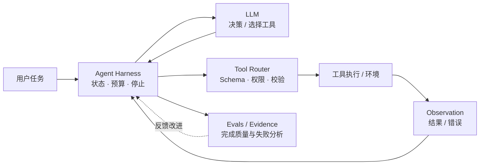

# AI Agent Engineering Handbook | 从 ReAct 到 Agent Harness

> **原理讲解 · 可运行示例 · 工具调用 · 工程约束 · 评测方法**

一本以中文为主的 AI Agent 工程实践手册，帮助开发者从“会调用大模型”走到“能设计、运行并评估 Agent 系统”。

**Start here:** [学习路线](agent-knowledge-base/docs/learning-roadmap.md) · [离线 5 分钟 Demo](agent-knowledge-base/examples/minimal-agent/README.md) · [真实 LLM 工具调用 Demo](agent-knowledge-base/examples/llm-tool-agent/README.md) · [评测指南](agent-knowledge-base/docs/evaluation.md)

## 为什么值得收藏？

| 你会得到 | 现有内容 |
| --- | --- |
| 一条可执行的学习路线 | 从 ReAct / Plan-and-Execute 到 Harness、MCP、Memory、Evals |
| **无需 Key** 就能跑的 Agent 执行循环 | 标准库离线 Demo，含预算、重试、结构化事件与回归用例 |
| 一个**真实模型**工具调用闭环 | Responses API + 安全计算器 + 离线模拟测试 |
| 不夸大结果的工程笔记 | 失败状态、约束边界、独立验收及工程模板 |

## 一图看懂 Agent 的职责边界



**设计原则：** 模型负责提议动作，Harness 负责执行边界，工具负责可检验的操作，评测负责判断任务是否真正完成。示意图是概念架构，并不代表仓库已实现全部生产级能力。

## 两种体验入口

**A. 零依赖离线 Demo**（不需要 API Key 或网络）：

```bash
git clone https://github.com/night-hunter-flex/Agent.git
cd Agent
python agent-knowledge-base/examples/minimal-agent/demo.py --expression "(12 + 8) * 3"
python agent-knowledge-base/examples/minimal-agent/run_eval.py
```

**B. 真实 LLM + 工具调用**（需要 API Key，可能产生费用）：

```bash
export OPENAI_API_KEY="your-key"  # Windows PowerShell 请看对应 README
python agent-knowledge-base/examples/llm-tool-agent/agent.py --expression "(12 + 8) * 3"
```

在线版会将工具结果通过 Responses API 送回模型。它是学习示例，不提供生产级沙箱或安全保证。详细限制与 PowerShell 命令见[在线示例说明](agent-knowledge-base/examples/llm-tool-agent/README.md)。

## 从这里开始

| 你的目标 | 建议入口 | 可以得到什么 |
| --- | --- | --- |
| 理解 Agent 如何工作 | [核心概念](agent-knowledge-base/docs/core-concepts.md) | 模型、工具、状态、Harness 和停止条件的分工 |
| 按顺序学习 | [学习路线](agent-knowledge-base/docs/learning-roadmap.md) | 四个阶段、对应资料和验收产物 |
| 找项目和选框架 | [GitHub 项目导航](agent-knowledge-base/resources/github-projects.md) · [选型指南](agent-knowledge-base/docs/framework-selection.md) | 项目定位、可借鉴设计和适用边界 |
| 体验真实 LLM 工具调用 | [在线 Agent Demo](agent-knowledge-base/examples/llm-tool-agent/README.md) | 真实模型执行受限计算器工具的完整闭环 |
| 动手完成一个项目 | [实践项目](agent-knowledge-base/docs/practice-projects.md) · [离线演示](agent-knowledge-base/examples/minimal-agent/README.md) | 从执行循环到带证据的资料助手 |
| 做稳定的工程系统 | [Harness 工程](agent-knowledge-base/docs/harness-engineering.md) | 预算、恢复、幂等性和运行记录 |
| 接工具和外部服务 | [工具与 MCP](agent-knowledge-base/docs/tools-and-mcp.md) | 输入输出契约、权限和协议边界 |
| 判断效果是否提升 | [评测指南](agent-knowledge-base/docs/evaluation.md) | 成功标准、失败分类和公平对照 |
| 增加协作与安全边界 | [多 Agent](agent-knowledge-base/docs/multi-agent.md) · [安全指南](agent-knowledge-base/docs/safety.md) | 委派、交接、审批和不可信输入处理 |

## 五分钟运行一个闭环

克隆仓库后，在仓库根目录执行。需要 Python 3.10 或更高版本，仅使用标准库，无需安装依赖、联网或配置 API Key。

```bash
git clone https://github.com/night-hunter-flex/Agent.git
cd Agent
python agent-knowledge-base/examples/minimal-agent/demo.py --expression "(12 + 8) * 3"
python agent-knowledge-base/examples/minimal-agent/demo.py --expression "12 / 3" --fail-first
python agent-knowledge-base/examples/minimal-agent/run_eval.py
```

演示用确定性策略模拟动作选择，展示参数校验、工具观察、有限重试、步数与调用预算、结构化事件和停止状态。它没有调用语言模型；样例通过率用于检查执行机制，不能代表 LLM 的任务能力。详见[演示说明](agent-knowledge-base/examples/minimal-agent/README.md)。

## 资料与模板

- [资料索引](agent-knowledge-base/resources/reading-list.md)：基础论文、记忆与反思、评测基准和官方工程文档。
- [资料分析卡片](agent-knowledge-base/resources/template.md)：记录来源、阅读范围、贡献、证据和局限。
- [项目复现卡片](agent-knowledge-base/templates/project-card.md)：记录提交、环境、运行命令和验收结果。
- [评测报告模板](agent-knowledge-base/templates/evaluation-report.md)：记录数据划分、预算、失败和对照结果。
- [来源核验说明](agent-knowledge-base/resources/verification-notes.md)：说明本轮整理范围、核验方法和维护状态变化。

## 目录结构

```text
Agent/
├── README.md
├── CONTRIBUTING.md
├── agent-knowledge-base/
│   ├── docs/                  # 概念与工程指南
│   ├── resources/             # 论文、项目与来源记录
│   ├── examples/minimal-agent/ # 离线闭环演示及回归用例
│   ├── examples/llm-tool-agent/ # 真实 LLM + 工具调用
│   └── templates/             # 复现与评测记录
├── scripts/check_docs.py     # 本地 Markdown 文件链接检查
└── .github/                  # 内容贡献模板与自动检查
```

## 整理原则与贡献

优先使用原始论文、作者仓库和官方文档；项目介绍与本库建议分开表述。框架信息标注核验日期，复现记录固定版本或提交，不用 Star 数作为质量排名。引用外部项目的设计时保留出处；复制代码、图片或数据前检查相应许可。

欢迎补充可复查的资料、复现记录、失败案例和文档修正。提交前请阅读[贡献指南](CONTRIBUTING.md)，并运行：

```bash
python scripts/check_docs.py
python -m unittest discover -s agent-knowledge-base/examples/minimal-agent -p "test_*.py"
python agent-knowledge-base/examples/minimal-agent/run_eval.py
```

如果本项目帮助你理解或实现 Agent，欢迎通过 **Star** 收藏，并在 Issues 中反馈真正需要解决的工程问题。

项目与官方文档的最近核验日期：**2026-10-10**。链接有效性、功能实现和实验效果是不同层次的证据；本库不宣称已复现所有收录项目。
