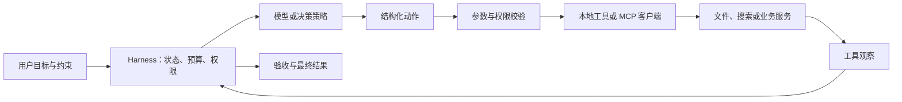

# Agent 核心概念

## Agent 与普通问答的区别

普通问答通常根据输入直接生成回答。Agent 会围绕目标持续执行：它可以选择动作、调用工具、接收外部结果，再根据新信息决定下一步。是否称为 Agent，关键看它是否存在由目标驱动的行动与反馈循环，而不是是否使用了某个特定框架。

## 一个最小运行循环

```text
目标与约束
    ↓
读取当前状态 → 选择下一步
    ↑               ↓
观察工具结果 ← 执行动作
    ↓
完成条件满足？——否→继续；是→输出结果
```

一次循环至少需要明确四件事：当前目标、可用动作、动作返回的观察结果、停止条件。

## 模型与 Harness

- **模型**根据上下文提出计划、选择动作或生成内容。
- **Harness**负责把模型放进可控的执行循环：准备上下文、调用工具、检查结果、限制预算、保存状态并处理失败。
- **工具**让 Agent 访问模型之外的能力，例如搜索、代码执行、文件读写或业务 API。
- **环境**是工具操作的对象，可能在调用后改变状态，因此下一步决策要基于新的观察。

模型提供判断能力；Harness 决定任务如何推进，以及执行是否安全、可恢复、可检查。

## 三种常见组织方式

| 方式 | 如何推进 | 适合场景 | 主要风险 |
| --- | --- | --- | --- |
| ReAct | 思考与动作交替，根据观察继续 | 信息不完整、需要探索 | 循环过长、重复调用 |
| Plan-and-Execute | 先制定步骤，再逐步执行和修订 | 多步骤目标、步骤大致可预见 | 初始计划可能过时 |
| 固定工作流 | 程序规定流程，模型处理局部判断 | 规则稳定、需要审计 | 灵活性较低 |

实践中可以组合使用：外层用固定流程约束高风险步骤，内部让 Agent 处理开放式子任务。

## 评审一个 Agent 任务

至少检查以下方面：

1. **目标完成**：最终产物是否满足明确的验收条件？
2. **证据充分**：关键结论是否由工具结果或可复查来源支持？
3. **过程受控**：是否遵守工具权限、时间和执行预算？
4. **失败可处理**：遇到错误时是否能重试、恢复、降级或交给人处理？

对于未见过的失败类型，可以先收集通用证据，再决定是否需要扩展专用分类；不要为了覆盖所有可能性而把流程做得无法维护。

## 状态、上下文与记忆

| 概念 | 记录什么 | 设计问题 |
| --- | --- | --- |
| 任务状态 | 已完成事实、待办、执行状态 | 能否从检查点继续？ |
| 上下文 | 本次调用可见的指令、证据和观察 | 哪些信息影响下一步？ |
| 会话历史 | 用户约束与前几轮结果 | 摘要能否回溯到原始记录？ |
| 长期记忆 | 跨任务的偏好与经验 | 如何更新、撤回和隔离用户？ |
| 检索资料 | 当前任务需要的外部证据 | 是否可信、过时或互相冲突？ |

检索增强生成（RAG）负责找相关资料；执行循环负责根据资料和工具反馈选择动作。两者可以组合，但“接了向量数据库”本身不能说明有完整的行动闭环。上表是本库的工程划分。

## 一次任务的数据流



MCP 提供上下文与工具交换协议，不规定应用如何规划任务。接通协议后仍须实现业务权限与验收；见[MCP 官方架构说明](https://modelcontextprotocol.io/docs/2026-07-28/learn/architecture)和[工具与 MCP](tools-and-mcp.md)。

## 停止状态

建议区分 `completed`（验收完成）、`failed`（无法恢复）、`budget_exceeded`（预算耗尽）、`waiting_for_human`（等待信息或审批）、`cancelled`（用户取消）。最终答案同时说明产物、证据、状态和未完成事项。

这是应用状态建议，不是所有框架共用的标准。[离线演示](../examples/minimal-agent/README.md)只实现前三种。

## 阅读依据与下一步

- [ReAct](https://arxiv.org/abs/2210.03629)：行动与观察交替；不要求展示模型的隐式思维过程。
- [Toolformer](https://arxiv.org/abs/2302.04761)：训练模型使用工具；运行时校验工具是另一个问题。
- [LangGraph](https://github.com/langchain-ai/langgraph)：学习持久执行与状态管理。
- 继续阅读：[Harness 工程](harness-engineering.md) · [实践项目](practice-projects.md)。
