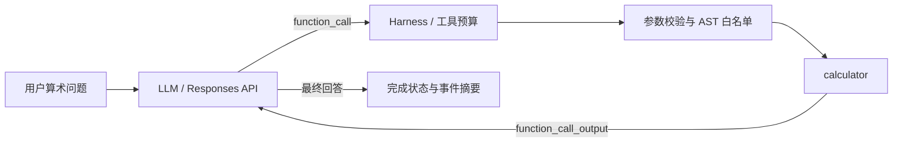

# 真实 LLM + 工具调用：最小 Agent

这是一个**教学用途**的 Python 示例：通过 OpenAI Responses API 让模型选择何时调用 calculator，再将安全执行后的工具结果传回模型，生成最终回答。它使用仓库已有的 [AST 白名单计算器](../minimal-agent/README.md)，只允许基本算术，**不会执行模型生成的 Python**。

## 快速开始

要求 Python 3.10+；仅依赖标准库。在线运行需要可用的 OpenAI API Key，模型调用可能产生费用。从仓库根目录：

```bash
# macOS / Linux
export OPENAI_API_KEY="your-key"
python agent-knowledge-base/examples/llm-tool-agent/agent.py --expression "(12 + 8) * 3"
```

Windows PowerShell:

```powershell
$env:OPENAI_API_KEY = "your-key"
python agent-knowledge-base/examples/llm-tool-agent/agent.py --expression "(12 + 8) * 3"
```

使用 `--model` 或 `OPENAI_MODEL` 选择支持工具调用的模型。默认示例模型为 `gpt-4.1-mini`，请按自己的账号权限和费用预算调整。不要把 Key 写进代码、日志或提交到 GitHub。

## 执行链



`agent.py` 使用 `previous_response_id` 和 `function_call_output` 形成工具调用闭环；限制总决策步数和工具调用次数，未取得工具观察不能成功结束。模型给出不合法表达式会收到结构化错误，而不是执行任意代码。

## 无网络测试

```bash
python -m unittest discover -s agent-knowledge-base/examples/llm-tool-agent -p "test_*.py"
```

`test_agent.py` 模拟 API 返回，覆盖调用闭环、预算、参数拒绝、缺失响应 ID 和网络失败。**测试不证明模型实际输出准确，也不调用线上 API。** 如需验证线上效果，应单独准备真实模型测试并记录模型版本、输入、实际输出、预算和成本。

## 当前边界

- 仅实现一个无外部副作用的 calculator 工具，未包含文件、Shell、联网搜索或 MCP。
- `max_steps` 是模型决策次数；`max_tool_calls` 是尝试执行工具的总次数。超额返回 `budget_exceeded`。
- HTTP 请求有超时，但没有全任务墙钟预算、重试退避、token 成本控制、审批或检查点恢复。
- 事件摘要不含原始参数；然而用户输入和工具结果会发送给模型服务，请勿输入敏感数据。
- 最终回答只检查是否调用过工具并非空，**不独立验证模型回答的事实正确性**；不要将这个示例直接作为生产系统。

与[离线示例](../minimal-agent/README.md)配合阅读，可区分确定性执行正确性与真实模型决策质量。
