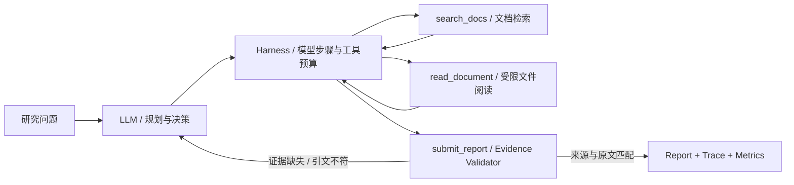

# Evidence-First Research Agent：多工具 + 证据校验的研究助手

> **旗舰工程示例**。与只调用 calculator 的入门 Demo 不同，这个项目让真实 LLM 自主决定搜索什么、读哪些文档、如何修正不合格的引用，并由独立的 Harness 决定是否允许完成任务。

运行环境：Python 3.10+，**仅使用标准库**。仅访问你显式提供的本地 Markdown 文档，除了向指定模型 API 发送任务及读取的材料，不具备 Shell、互联网检索或写文件能力。

## 系统设计



| 机制 | 具体实现 | 有意未实现 |
| --- | --- | --- |
| 多步 Agent 循环 | 模型调用工具、读取观察、再次选择动作 | 非固定工作流或无限自主执行 |
| 工具路由 | 3 个严格 JSON Schema 函数工具 | Shell、Web 搜索、外部写入 |
| 有界上下文 | 文档数、每篇大小、检索数、每次读取行数均有限额 | 向量检索、跨文档语义重排 |
| 访问权限 | 指定文档根目录内已索引的 Markdown、检索后才能读 | 可抵御恶意本地管理员的 OS 级沙箱 |
| 结果核验 | 引用必须是该次运行中**读过的行**，引文为精确原文子串 | 判断每条论断是否被语义充分支持 |
| 预算 / 停止 | 模型步骤数、工具调用数、墙钟预算、请求超时 | token 费用硬上限、持久检查点 |
| 运行追踪 | 事件类别、工具、错误代码、耗时与 token 使用 | 自动评测 LLM 回答的事实准确性 |

## 快速体验：不用 API Key

在仓库根目录运行：

```bash
python agent-knowledge-base/examples/research-agent/run_eval.py
python -m unittest discover -s agent-knowledge-base/examples/research-agent -p "test_*.py"
```

离线演练使用确定性的**假模型响应**，但经过与线上运行相同的工具注册、预算与证据核验逻辑。预期包含正常完成、错误引用纠正、非法路径拒绝和额度耗尽。它只验证 Harness 行为，不代表真实 LLM 成功率。

## 真实 LLM 运行

macOS / Linux：

```bash
export OPENAI_API_KEY="your-key"
python agent-knowledge-base/examples/research-agent/research_agent.py \
  --question "How should Agent Harness handle tool failures and budgets?"
```

Windows PowerShell：

```powershell
$env:OPENAI_API_KEY = "your-key"
python agent-knowledge-base/examples/research-agent/research_agent.py --question "How does an Agent Harness enforce tool budgets?"
```

默认只检索仓库的 `agent-knowledge-base/docs/`，无需额外数据下载。可用 `--docs-root` 指定自己的 Markdown 目录；**所选目录中的文档片段可能发送给模型 API**，切勿选择机密资料目录。可通过 `--model` 或 `OPENAI_MODEL` 选择支持工具调用的模型；默认示例模型为 `gpt-4.1-mini`，账号可用模型及费用以供应商为准。

预算选项：`--max-steps 10 --max-tool-calls 12 --max-seconds 90`。默认调用超时为 20 秒或剩余总预算中较小者，失败会返回状态，而不是伪装成完成。

## 一次多步运行的逻辑

```text
Question
  → search_docs(query, max_hits)     # 找到候选文件和行号
  → read_document(path, line range)  # 读取原文并记录已观察证据
  → submit_report(summary, claims)
       ├─ 引用路径/行号不在已读证据中 → rejected: source_not_observed
       ├─ 引用不是该行原文子串       → rejected: quote_not_found
       └─ 引用匹配                   → completed
  → metrics(model_calls, tool_calls, tokens, elapsed_ms, verified_claims)
```

每条 claim 必须包含 `claim`、`source`、`line`、`quote`。模型不得仅通过自然语言说“完成”；必须调用 `submit_report` 并通过代码核验。若没有证据，最终应以明确的未完成/预算状态结束，而非编造引用。

## 安全边界与质量边界

1. 文档可能有 prompt injection；模型被要求把它们当作**不可信数据**，但这项提示不是可靠的安全隔离。由于工具集只有本地只读文档操作，没有 Shell 或外部业务写入，影响范围被限制；模型 API 仍会接收所选文本。
2. 引文检查只能证明“引用来自已读文档”，**不能证明摘要或 claim 逻辑上正确**。生产级系统还需独立的 claim-level entailment / 人工复查。
3. 路径索引过滤目录外文件及符号链接，但它不是防御敌对本地进程进行路径竞态攻击的系统级沙箱。
4. 这不是持久任务引擎：没有跨进程恢复、长期记忆、真实成本硬限、可扩展检索基础设施或可靠的反思收益保证。
5. `run_eval.py` 是确定性行为回归；线上报告质量必须另外用固定测试集衡量任务成功率、证据支持率、预算消耗和失败类型。

## 从源码开始读

- [research_agent.py](research_agent.py)：Corpus → search/read → submit_report → run_research → 模型适配
- [test_research_agent.py](test_research_agent.py)：正常路径、拒绝与纠正、工具预算、权限边界、Trace 不泄漏
- [run_eval.py](run_eval.py)：可复现的离线情境与行为通过率，明确区分完成和预期拒绝
- [Harness 工程指南](../../docs/harness-engineering.md) · [评测指南](../../docs/evaluation.md)

若希望继续进阶，建议下一步增加**真实任务集 + 语义级证据判断 + checkpoint 恢复**，再比较策略的成功率、成本和失败分布。
